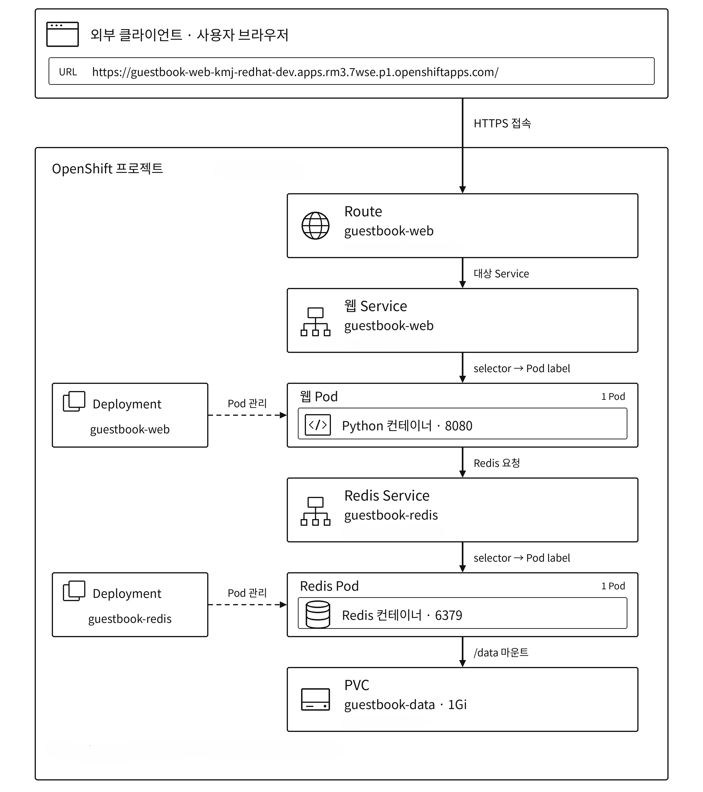
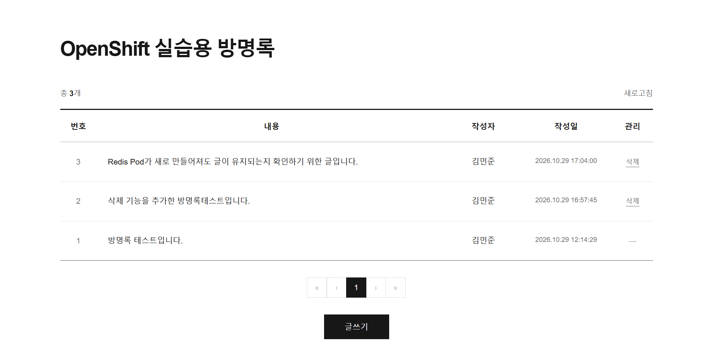
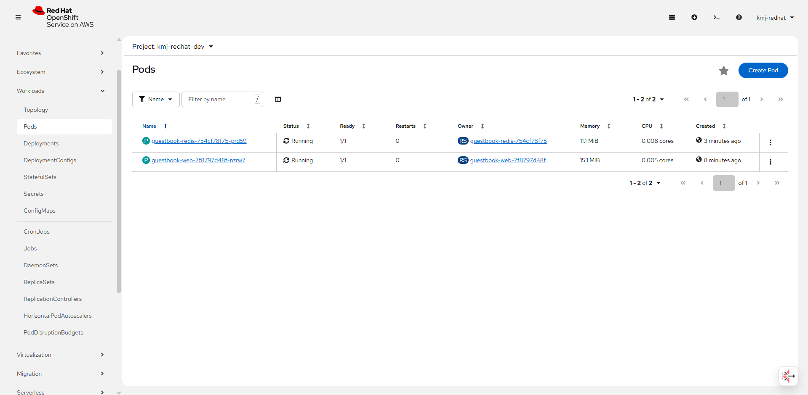
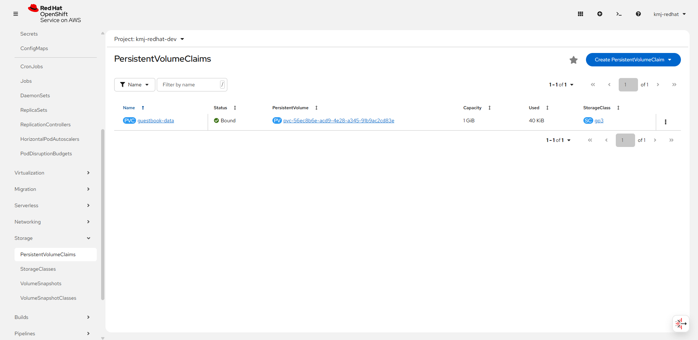
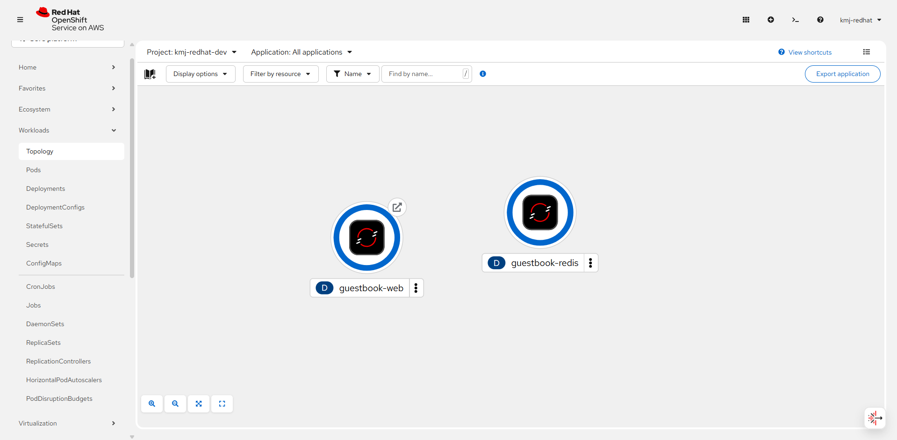

# OpenShift 실습용 방명록


## 1. 컨테이너 소개

Python 웹 서버와 Redis로 구성한 방명록입니다. 웹과 데이터베이스를 분리해 배포하고, Service를 통한 통신과 PVC를 이용한 데이터 보존을 확인하기 위해 이 주제를 선택했습니다.

주요 기능은 다음과 같습니다.

- 작성자, 내용, 삭제 비밀번호를 입력해 글 등록
- 최신 글부터 조회 및 10개 단위 페이지 이동
- 작성 시 지정한 비밀번호로 글 삭제
- Redis Pod 재생성 후 기존 글 유지


## 2. 아키텍처



각 Deployment는 Pod 1개를 유지합니다.
외부 사용자는 웹 Route의 URL로 방명록에 접속합니다. 웹 서버는 클러스터 내부의 Redis Service를 통해 데이터를 읽고 저장합니다. Redis는 내부 통신에만 사용하므로 별도의 외부 접속 경로는 구성하지 않았습니다.

### 사용한 Object

| 종류 | 이름 | 역할 |
| --- | --- | --- |
| Deployment | `guestbook-web` | Python 웹 서버 실행 및 Pod 유지 |
| Deployment | `guestbook-redis` | Redis 실행 및 Pod 유지 |
| Service | `guestbook-web` | 웹 Pod의 8080 포트 연결 |
| Service | `guestbook-redis` | Redis Pod의 6379 포트 연결 |
| Route | `guestbook-web` | 외부 HTTPS 접속 제공 |
| ConfigMap | `guestbook-web-config` | Python 코드, 화면 제목, Redis 주소·포트 저장 |
| ConfigMap | `guestbook-redis-config` | Redis 저장 경로 및 AOF 설정 |
| Secret | `guestbook-secret` | 웹과 Redis가 함께 사용하는 DB 접속 비밀번호 저장 |
| PersistentVolumeClaim | `guestbook-data` | Redis 저장 공간 요청: 1Gi, ReadWriteOnce |

웹 코드는 ConfigMap에서 `/app/app.py`로 마운트해 실행합니다. Python 표준 라이브러리를 사용하므로 별도의 이미지 빌드나 패키지 설치가 필요하지 않습니다.

### 데이터 보존

Redis의 `/data`에 PVC를 연결했습니다. AOF는 데이터 변경 내역을 파일로 기록하는 방식으로, Redis가 다시 시작될 때 이 파일을 읽어 데이터를 복원합니다.

- `appendonly yes`: AOF 사용
- `appendfsync always`: 매 쓰기마다 디스크 동기화
- `storageClassName` 생략: 배포 환경의 기본 StorageClass 사용
- Redis Deployment의 `Recreate`: 기존 Pod 종료 후 새 Pod 실행

### 상태 검사와 리소스

Probe는 Deployment의 컨테이너 설정에 포함했습니다. Startup은 기동 완료, Liveness는 컨테이너 재시작 필요 여부, Readiness는 요청을 받을 준비가 되었는지 검사합니다.

| 대상 | Startup / Liveness | Readiness |
| --- | --- | --- |
| 웹 | `/healthz`로 웹 서버 응답 확인 | `/readyz`로 Redis 연결 및 PING 응답 확인 |
| Redis | 인증 후 `redis-cli ping` 실행 | 인증 후 `redis-cli ping` 실행 |

두 컨테이너 모두 requests는 CPU `50m`·메모리 `64Mi`, limits는 CPU `250m`·메모리 `256Mi`로 지정했습니다. Redis의 `maxmemory`는 `64mb`이며, 메모리 한도에 도달해도 기존 글을 자동 제거하지 않도록 `noeviction`을 사용했습니다.


## 3. 사용 이미지

| 용도 | 이미지 | 포트 | 선택 이유 |
| --- | --- | --- | --- |
| 웹 | `public.ecr.aws/docker/library/python:3.12-slim` | 8080/TCP | 필요한 Python 실행 환경을 작은 이미지로 제공 |
| DB | `public.ecr.aws/docker/library/redis:7.2.17-alpine` | 6379/TCP | 방명록 저장에 필요한 자료구조와 AOF 기능 제공 |

두 이미지 모두 Public ECR의 공개 이미지를 사용했습니다. 비루트 실행과 권한 상승 금지를 설정했으며, Route는 edge TLS 종료 방식으로 HTTPS를 제공하고 HTTP 요청을 HTTPS로 리다이렉트합니다.


## 4. 배포 방법

OpenShift에 로그인한 `oc` CLI 환경에서 실행합니다. 프로젝트에 기본 StorageClass가 있고, PVC 1Gi를 생성할 수 있는 여유 용량이 필요합니다.

```bash
git clone https://github.com/kmj345/openshift-guestbook.git
cd openshift-guestbook/students/202155527

oc project OpenShift_프로젝트_이름
oc apply -f k8s/
oc rollout status deployment/guestbook-redis --timeout=300s
oc rollout status deployment/guestbook-web --timeout=300s
```

`k8s/`에는 위 Object에 해당하는 YAML 9개가 있습니다. 다른 환경에도 배포할 수 있도록 namespace, uid, resourceVersion, status, Route host 등 환경별 값과 자동 생성 항목을 제외했습니다. Secret에는 실습용 비밀번호가 포함되어 있습니다.

### 실행 확인

```bash
oc get all -l app=guestbook
oc get pvc guestbook-data
oc get route guestbook-web
```

두 Pod가 `Running`, Ready `1/1`이고 PVC가 `Bound`인지 확인합니다. Route의 `HOST/PORT`에 나온 주소를 `https://`로 접속하면 방명록이 표시됩니다. 처음 배포한 환경에서는 목록이 비어 있으며, 글 등록과 비밀번호 삭제를 시험할 수 있습니다.

### 전체 재배포 검증

제출 YAML만으로 다시 배포할 수 있는지 확인하는 절차입니다. **PVC도 삭제하므로 기존 방명록 데이터가 삭제될 수 있습니다.**

```bash
oc delete -f k8s/ --wait=true
oc apply -f k8s/
oc rollout status deployment/guestbook-redis --timeout=300s
oc rollout status deployment/guestbook-web --timeout=300s
```

이후 위의 실행 확인 절차로 Pod, PVC, Route와 방명록 기능을 확인합니다.


## 5. 배포 결과

배포 후 다음 항목을 확인했습니다.

| 확인 항목 | 결과 |
| --- | --- |
| Route 접속 | 방명록 화면 표시 |
| 글 등록 및 비밀번호 삭제 | 정상 동작 |
| 웹 / Redis Pod | 모두 Running, Ready 1/1 |
| PVC | guestbook-data, Bound, 1Gi |
| Redis Pod 재생성 | 기존 글 유지 |

데이터 보존은 확인용 글을 작성한 뒤 Redis Pod만 삭제해 검사했습니다. 새 Pod가 준비된 후 방명록을 새로고침했으며, 기존 글이 남아 있었습니다. 이때 PVC는 삭제하지 않았습니다.










## 6. 어려웠던 점

| 문제 | 원인 및 해결 |
| --- | --- |
| `SyntaxError: unterminated triple-quoted string literal` | ConfigMap의 Python 코드 일부가 누락되었습니다. 전체 코드로 교체하고 웹 Pod를 재생성했습니다. |
| 글 등록 시 403 응답 | `Referrer-Policy: no-referrer` 설정으로 요청의 Origin이 `null`이 되어 앱의 검사에 걸렸습니다. 정책을 `same-origin`으로 수정하고 웹 Pod를 재생성했습니다. |
| 실습 재개 시 Redis Pod가 없음 | Deployment의 replicas가 0이었습니다. 1로 변경해 Pod를 실행했습니다. |


## 7. AI·참고자료 활용 내역

ChatGPT를 YAML과 Python 코드 작성·수정, 오류 분석, README 정리에 활용했습니다.

- 수업 자료: 「나만의 컨테이너 만들기」 과제 안내
- [Kubernetes — Persistent Volumes](https://kubernetes.io/docs/concepts/storage/persistent-volumes/)
- [Redis — Persistence](https://redis.io/docs/latest/operate/oss_and_stack/management/persistence/)
